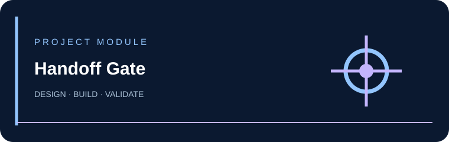

**INDEPENDENT ENGINEERING PORTFOLIO · HANDOFF GATE**

[GitHub Profile](https://github.com/sghatge) · [Portfolio](https://sghatge.github.io/adobe-campaign-v8-governance/)

---

# Handoff Gate

A deterministic, policy-based checkpoint between an AI planning agent and campaign activation.

**GO · HOLD · BLOCK**

Every check is named. Every HOLD names the person who can clear it. Every verdict is fingerprinted so the evaluated package and policy version can be audited.

## Live pages

- [Project homepage](https://sghatge.github.io/handoff-gate/)
- [Interactive Handoff Gate demo](https://sghatge.github.io/handoff-gate/demo/)
- [Six-slide carousel](https://sghatge.github.io/handoff-gate/carousel/)

## What it does

- Fail-closed decisions: missing evidence cannot silently pass.
- Deterministic policy checks; no LLM in the decision path.
- SHA-256 audit fingerprint over the evaluated package and policy version.
- Designed to support browser, Node.js, and CI workflows.

## Demo data and affiliation

All demo data is synthetic (fictional retailer “Lumen & Loom”). This is an independent project by Sangram Ghatge and is not affiliated with or endorsed by Adobe.

## GitHub Pages deployment

1. Upload the contents of this package to the repository root on branch `main`.
2. Open **Settings → Pages**.
3. Choose **Deploy from a branch**.
4. Select branch `main` and folder `/(root)`, then save.
5. Wait for the Pages deployment in **Actions** to complete.
6. Test the homepage, demo, and carousel in a private/incognito window.

Keep the existing MIT `LICENSE` file. This package includes the MIT license supplied with the project.

---

## Portfolio, reproducibility & safe use

- [Sangram Ghatge — complete engineering portfolio](https://github.com/sghatge/sghatge)
- [OPSFORGE Build Lab](https://sghatge.streamlit.app/) — portfolio index only; this project is documented and maintained in its own repository.

**Reproducibility:** start with the setup and usage instructions in this README and the linked project documentation. Run the repository's available checks before changing behaviour; if no test command is documented, treat that as a validation task rather than assuming tests pass.

**Safe-use boundary:** this is an independent portfolio project. Use synthetic or sanitized examples. Do not treat sample configurations, assessments, checklists or simulated outputs as production approvals or connect the project to customer data or live enterprise systems without independent security, privacy, legal and operational review. Review dependencies, licences and secrets handling before deployment.
